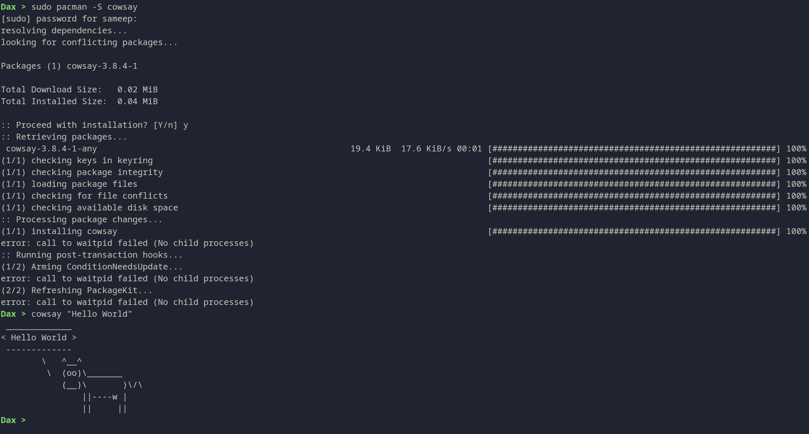

# Dax

Dax is a customizable Unix shell with an interactive prompt and Janet-powered configuration and scripting.



## Features

- Commands, pipelines, redirection, and background jobs
- Shell variables, aliases, functions, and common control-flow syntax
- Indexed and associative arrays, parameter expansion, here-strings, and process substitution
- Bash `[[ ... ]]` conditionals, arithmetic commands, and arithmetic `for` loops
- `pipefail`, `errexit`, and `ERR` traps
- Command history, Tab completion, and inline suggestions
- Git branch prompt and configurable colors
- Janet configuration, scripts, and registered shell commands

Dax combines familiar shell syntax with a practical set of Bash-inspired
features.

## Build and run

Building requires C and C++17 compilers, GNU Make, and terminal capability
library development files (such as ncurses). GNU Readline is included in the
source tree and linked into Dax. On macOS and FreeBSD, install GNU Make and
run `gmake` in place of `make`. Set `CC` and `CXX` to select compilers; run
`make clean` before changing the compiler or build flags.

## Tests

Run `make test` (or `gmake test` on macOS and FreeBSD). It builds Dax and
runs the shell integration, Bash and POSIX comparison, and interactive terminal
tests. Python 3, Bash 4.4 or newer, and standard Unix utilities are required; the POSIX
comparison uses dash or BusyBox when available and reports a skip otherwise.
Linux-only restricted Janet checks are skipped on other platforms.

Shell tests live in `tests/shell/` and can be run with `./dax` followed by
the `.dax` test path. The pattern comparison can be run with
`python3 tests/shell/pattern_matching.py ./dax`. Interactive tests live in
`tests/interactive/` and run with `python3 tests/interactive/<test>.py ./dax`.
The matcher unit test can be run with `make build/pattern-match-test` followed
by `./build/pattern-match-test`.

```sh
make
./dax
```

Run a command with Dax's shell parser:

```sh
./dax -c 'git status && echo done'
```

Run a Janet script:

```sh
./dax --janet script.janet
```

Use `dax --help` to see command-line options.

## Janet configuration

Dax reads `$XDG_CONFIG_HOME/dax/init.janet`, or
`~/.config/dax/init.janet` if `XDG_CONFIG_HOME` is unset. Create this file
yourself; Dax does not create it. Reload changes in a running shell with:

```sh
source ~/.config/dax/init.janet
```

For example, set an alias, disable the Git branch prompt, or register a Janet
function as a shell command:

```janet
(dax/alias "gs" "git status")
(dax/set-git-branch false)
(dax/history-config {:memory-limit 10000
                     :file-limit 10000
                     :ignore-duplicates false
                     :ignore-space false})

(defn greet [name]
  (print "Hello, " name))
(dax/register-command "greet" greet)
```

Then `greet Sameep` invokes the Janet function. Use
`(dax/unregister-command "greet")` to remove it.

History is appended as commands are entered and defaults to `~/.dax_history`.
`dax/history-config` accepts `:file`, `:memory-limit`, `:file-limit`,
`:ignore-duplicates`, and `:ignore-space`; history is loaded at startup, so
entries from other Dax sessions appear the next time Dax starts.

Janet 1.42.1 is embedded in the repository under `vendor/janet`; a separate
Janet installation is not required.
