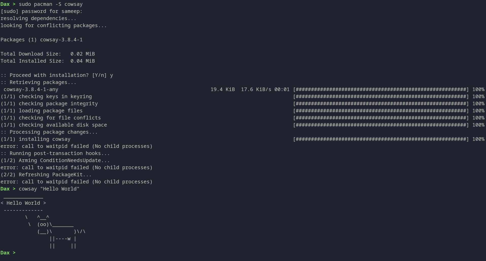

# Dax Shell

Dax is a custom Unix shell implementation written in C++. It provides a familiar command-line interface with support for standard shell features, including command execution, piping, redirection, and built-in commands.



## Features

- **Custom Prompt**: Displays the current directory name in green.
- **Command Execution**: Run standard Linux commands (e.g., `ls`, `grep`, `vim`).
- **Piping**: Connect commands using pipes (`|`).
- **Redirection**: Support for input (`<`), output (`>`), and append (`>>`) redirection.
- **Command Lists**: Execute multiple commands sequentially using semicolons (`;`).
- **Conditional Lists**: Use Bash-style `&&`, `||`, and `!` with short-circuit execution.
- **Compound Commands**: Brace groups, subshells, conditionals, case statements, and while, until, and for loops.
- **Shell Variables and Functions**: Basic variable assignment, parameter expansion, unquoted word splitting and globbing, aliases, and shell functions with positional parameters and local variables.
- **Background Jobs**: Start a command with `&` and manage basic jobs with `jobs`, `fg`, `bg`, and `wait`.
- **Built-in Commands**: Navigation and directories (`cd`, `pwd`, `pushd`,
  `popd`, `dirs`); variables and functions (`export`, `typeset`, `local`,
  `readonly`, `unset`, `return`, `shift`, `getopts`); command lookup
  (`command`, `builtin`, `type`, `whence`, `which`, `hash`); scripting and
  output (`echo`, `printf`, `read`, `test`, `[`, `eval`, `source`, `.`); job
  control (`jobs`, `fg`, `bg`, `wait`, `disown`, `kill`, `suspend`); aliases,
  options, traps, loop control, `true`, `false`, and `exit`.
- **Interactive Editing**: Persistent history in `~/.dax_history`, inline history autosuggestions accepted with Right Arrow or End, and Tab completion for commands, builtins, aliases, shell functions, variables, files, and directories.
- **Interactive Colors**: The default `dax` scheme highlights known commands green, unknown commands red, and history suggestions gray. Select `high-contrast` or `no-color` in `~/.config/dax/init.janet` with `(dax/set-colorscheme "high-contrast")`. `NO_COLOR` disables Dax theme colors.
- **Git Prompt**: In a Git repository, the default prompt shows the current branch in brackets, for example `Dax [main] >`. Disable it in `~/.config/dax/init.janet` with `(dax/set-git-branch false)`.
- **Signal Handling**: Handles `SIGINT` (Ctrl+C), shell signal traps, and exit traps.
- **Janet Scripting**: Run embedded Janet 1.42.1 scripts with Dax state helpers.

## Installation

### Build

1. Clone the repository:

   ```bash
   git clone https://github.com/sameepkat/Dax.git
   cd Dax
   ```

2. Compile the project using `make`:

   ```bash
   make
   ```

   This will create an executable named `dax`.

## Usage

Start the shell by running the executable:

```bash
./dax
```

`dax --help` lists the supported startup options, and `dax --version` prints
the build version (`development` for a local build and the package version for
release builds). Dax follows POSIX-style invocation modes and supports the
standard shell flags `-a`, `-b`, `-C`, `-e`, `-f`, `-i`, `-m`, `-n`, `-s`,
`-u`, `-v`, and `-x`, including `+` forms for disabling shell options.
`-l` is also accepted as a login-shell flag for Termux. `--` terminates startup
option parsing. This covers invocation and these option behaviors; it does not
claim full POSIX shell-language conformance.

Run one shell command with Dax's parser, or execute a Janet script with its
remaining arguments exposed as the global `args` array:

```bash
./dax -c 'false || echo recovered'
./dax -e -c 'false' script-name argument
./dax -l
./dax -s first-argument < commands.dax
./dax script.dax argument
./dax -- script.dax argument
./dax --script script.dax argument
./dax --janet automation.janet project-name
./dax --janet-restricted ./workspace agent.janet task-argument
```

The supported shell syntax includes simple commands, pipelines, `;`, `&`,
`&&`, `||`, `!`, parenthesized subshells, brace groups, `if`/`elif`/`else`,
`case`, explicit-list `for` loops (and positional-parameter loops without
`in`), and `while`/`until` loops. Common parameter expansion, including
`$@`/`$*`, prefix/suffix pattern removal, tilde expansion, integer arithmetic,
quote removal, unquoted word splitting using `IFS` (space, tab, and
newline by default), pathname expansion, and
`$(...)` command substitution are supported. Common unset-only and
null-or-unset default/assign/alternate/error parameter operators and
`${#name}` are included. Redirections include
`<`, `>`, `>>`, `2>`, `2>>`, `&>`, `&>>`, and standard descriptor duplication
or closure (`2>&1`, `>&-`, `<&0`). `<<` and `<<-` here-documents
support quoted delimiters and basic parameter and command substitution.
Here-strings, arrays, process substitution, and advanced Bash parameter
operators are not implemented yet. `umask`, `times`, and common `ulimit`
queries/updates are available as builtins.
`break` and `continue` work for one loop level. Common `set -e` cases are
handled, including conditional and logical-list contexts. Unsupported syntax
such as `[[ ... ]]`, `select`, `coproc`, and the `time` reserved word is
rejected before earlier commands in that input run. Parse and quote errors
report a line and column.
With no command or script operand, Dax reads commands from standard input and
starts interactively only when stdin and stderr are terminals; `-i` forces an
interactive session. `-s` explicitly selects stdin input, while `-l` marks a
login-shell invocation. Interactive startup reads the optional Janet
configuration at `$XDG_CONFIG_HOME/dax/init.janet` or
`~/.config/dax/init.janet`; Dax does not create this file.

`dax -c` uses the same parser and returns the final command status. This is a
practical subset; it does not claim full Bash compatibility. Dax prints a job
id and process id when starting a background job, including in `-c` mode.
In `-c COMMAND [NAME [ARG...]]`, `NAME` becomes `$0` and remaining values are
the positional parameters; when omitted, `$0` is `dax`. For Dax scripts, `$0`
is the script path and values after the path become positional parameters.
`ERR` traps and exact Bash `errexit` behavior in every compound-command context
are not implemented. `pipefail` is unsupported, so a pipeline's status is its
last command's status.

Janet startup configuration is read from
`$XDG_CONFIG_HOME/dax/init.janet`, or `~/.config/dax/init.janet` when
`XDG_CONFIG_HOME` is unset. Startup errors are reported and Dax continues to
the interactive prompt. In a running shell, `source file.janet` or
`. file.janet` evaluates a Janet file in the current runtime, so aliases,
environment changes, and colorscheme settings take effect immediately;
registered startup hooks run after each successful Janet source. Other files
continue to use Dax shell syntax. The `dax/cd`, `dax/cwd`, `dax/getenv`,
`dax/setenv`, and `dax/execute` functions operate against Dax state.
`dax/execute` accepts an argv array or tuple and an optional table with
`:cwd`, `:env`, `:timeout-ms`, `:capture-output`, and `:max-output-bytes`. It
returns a table containing `:stdout`, `:stderr`, `:exit-code`, `:timed-out`,
and `:truncated`. It never parses the argument vector as shell source.
`dax/alias`, `dax/set-prompt`, `dax/set-colorscheme`, `dax/set-git-branch`, and `(dax/on :startup fn)` support startup
configuration. Choose `"dax"`, `"high-contrast"`, or `"no-color"` with
`(dax/set-colorscheme "dax")`; `NO_COLOR` disables Dax theme colors. Janet's own `os/*` functions remain available to trusted scripts
and do not share Dax's shell state.
Register a Janet function as an interactive shell command with
`(dax/register-command "name" function)`. Dax passes each command-line argument
as a string argument to the function; an integer return value becomes the
command's exit status. Use `(dax/unregister-command "name")` to remove one.
For example, after defining a Janet function named `z`, add
`(dax/register-command "z" z)` to make `z projects` invoke it.

Restricted Janet scripts run with
`dax --janet-restricted <workspace> <script.janet> [args...]`. This mode is
Linux-only and fails closed unless Landlock and seccomp restrictions are
available. Janet `os/*` and `ffi/*` bindings are removed. Scripts use
`dax/session-create`, `dax/session-execute`, and `dax/session-close`; session
commands are argv-based, run within the workspace and a private temporary
directory, have a default 30-second timeout and 1 MiB output cap, and have
network access disabled by default. `dax/request-approval` validates workspace
paths in C++ and requests explicit approval. `dax/remove-tree` uses that flow
and denies requests when paths leave the workspace or no controlling terminal
is available.

The build embeds the official Janet 1.42.1 amalgamated source under
`vendor/janet`; a system Janet installation is not needed.

### Examples

**Navigation and File Operations:**

```bash
Dax > ls -la
Dax > cd ..
Dax > pwd
```

**Piping and Redirection:**

```bash
Dax > ls | grep cpp > sources.txt
Dax > cat sources.txt
```

**History:**

```bash
Dax > history
Dax > history 10  # Show last 10 commands
```

**Environment Variables:**

```bash
Dax > export MY_VAR=hello
Dax > echo $MY_VAR
```

## Project Structure

- `main.cpp`: Entry point, main loop, and prompt handling.
- `parser.cpp` / `parser.hpp`: AST construction and execution logic.
- `tokenizer.cpp` / `tokenizer.hpp`: Lexical analysis and token generation.
- `builtins.cpp` / `builtins.hpp`: Implementation of built-in shell commands.
- `helper.cpp` / `helper.hpp`: Utility functions.
- `signal_handler.cpp` / `signal_handler.hpp`: Signal handling setup.
- `Makefile`: Build configuration.
