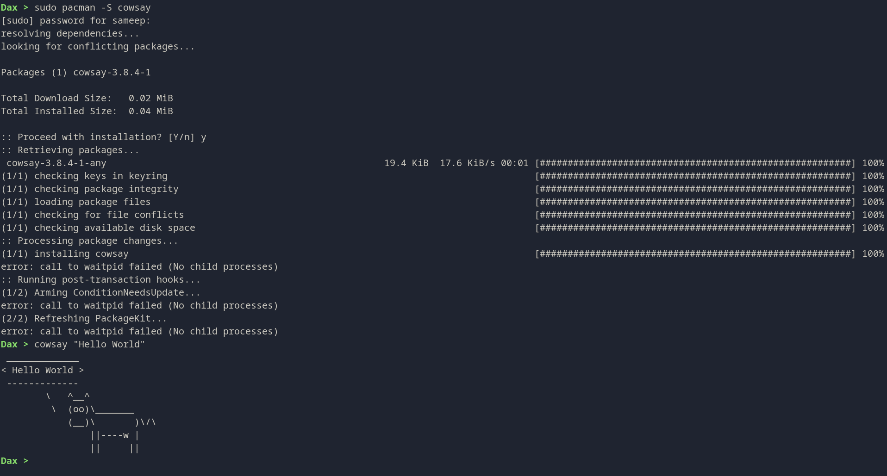

# Dax

Dax is a Unix shell written in C++ with an embedded Janet scripting layer.



## Features

- Commands, pipelines, redirection, and background jobs
- Shell variables, aliases, functions, and common control-flow syntax
- Indexed arrays, parameter expansion, here-strings, and process substitution
- `pipefail`, `errexit`, and `ERR` traps
- Command history, Tab completion, and inline suggestions
- Git branch prompt and configurable colors
- Janet configuration, scripts, and registered shell commands

Dax implements a practical subset of common shell behavior; it is not fully
POSIX or Bash compatible. Bash-specific additions are supported where listed;
check the differential tests for the current compatibility boundary.

## Build and run

```sh
make
./dax
```

Run a command with Dax's shell parser:

```sh
./dax -c 'git status && echo done'
```

Run a Janet script:

```sh
./dax --janet script.janet
```

Use `dax --help` to see command-line options.

## Janet configuration

Dax reads `$XDG_CONFIG_HOME/dax/init.janet`, or
`~/.config/dax/init.janet` if `XDG_CONFIG_HOME` is unset. Create this file
yourself; Dax does not create it. Reload changes in a running shell with:

```sh
source ~/.config/dax/init.janet
```

For example, set an alias, disable the Git branch prompt, or register a Janet
function as a shell command:

```janet
(dax/alias "gs" "git status")
(dax/set-git-branch false)
(dax/history-config {:memory-limit 10000
                     :file-limit 10000
                     :ignore-duplicates false
                     :ignore-space false})

(defn greet [name]
  (print "Hello, " name))
(dax/register-command "greet" greet)
```

Then `greet Sameep` invokes the Janet function. Use
`(dax/unregister-command "greet")` to remove it.

History is appended as commands are entered and defaults to `~/.dax_history`.
`dax/history-config` accepts `:file`, `:memory-limit`, `:file-limit`,
`:ignore-duplicates`, and `:ignore-space`; history is loaded at startup, so
entries from other Dax sessions appear the next time Dax starts.

Janet 1.42.1 is embedded in the repository under `vendor/janet`; a separate
Janet installation is not required.
